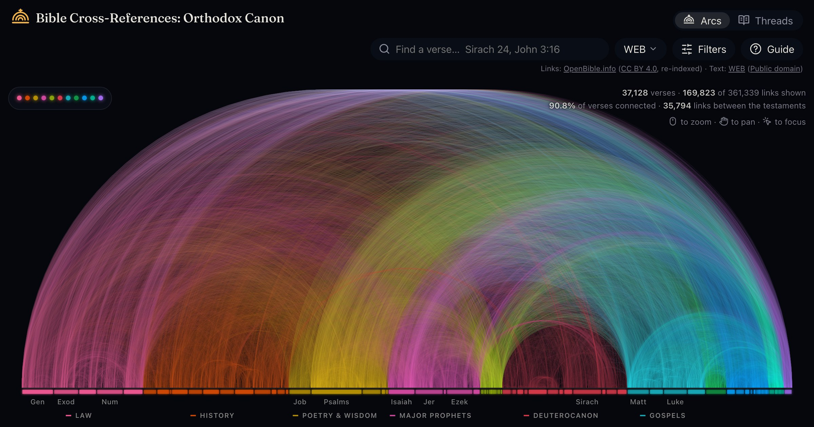

# Bible Cross-References: Orthodox Canon

[](https://wirewrestler1.github.io/bible-cross-references/)

See how the Bible is woven together — the deuterocanon included — and read any passage with its
connections in view.

**▶ [Open Bible Cross-References: Orthodox Canon](https://wirewrestler1.github.io/bible-cross-references/)**

This is a fork of [Bible Cross-References](https://trekhleb.dev/bible-cross-references/) by
[Oleksii Trekhleb](https://trekhleb.dev), which drew the cross-references of the 66-book
Protestant canon. Everything that fork does, this one does too; what it adds is the rest of the
Orthodox Bible — Tobit, Judith, Greek Esther, Wisdom, Sirach, Baruch with the Letter of Jeremiah,
Greek Daniel with Susanna and Bel, 1–3 Maccabees, 1 Esdras, the Prayer of Manasseh, Psalm 151,
and 4 Maccabees as an appendix — with cross-references into and out of those books, which no open
compilation had. The original's code is MIT and stays MIT; its author is credited here and in the
page's structured data.

## Why this exists

For centuries, readers of the Bible have followed cross-references: the small notes in the margin
that send you from one passage to another that echoes, quotes or fulfills it. The _Treasury of
Scripture Knowledge_ alone lists hundreds of thousands of them — but it stops at the 66 books. A
reader of an Orthodox or Catholic Bible has fourteen more, and the New Testament quotes and
alludes to them constantly: Hebrews 11 remembers the mother and her seven sons from 2 Maccabees
7, Romans 1 follows Wisdom 13 almost line by line, Matthew 11's "my yoke is easy" answers
Sirach 51. On paper those links stay in a study Bible's notes, if anywhere.

This project draws all of them at once: the Treasury's links across the 66 books, and three
further kinds that reach the deuterocanon (see [Data](#data)). You can start from a bird's-eye
view of the whole canon, zoom down to a single verse, and read it in context with every connection
one click away.

It is free, open source, and built only on openly licensed data.

## What you can do

### Arcs: the whole canon at once


- All 37,128 verses of the 80 books sit on one line, from Genesis to Revelation with the
  deuterocanon as its own crimson region between Malachi and Matthew, and every cross-reference
  is an arc colored by the genres it connects.
- Zoom from the whole canon down to single verses; hover a passage to see how many connections it
  has.
- Search for any reference ("John 3:16", "Sir 24", "Susanna 1:5", "Psalm 151") or click a
  passage to see where its links land. As you type, the box offers the books your typing could
  become, then the book's chapters, then the chapter's verses, so a verse is three taps away.
- Read it in seven translations — English (World English Bible with the deuterocanon, Berean
  Standard Bible, King James Version), Portuguese, German, Italian and Spanish. Only the World
  English Bible carries the deuterocanonical books; the others say so where one would be shown.
- Filter by weight, hide a genre, or hide a kind of link — Classic references (the Treasury's),
  Swedish Bible notes (the 1917 apparatus), Hand-picked, Similar wording. A guide on the first
  visit, and behind the "?" after that, says what each of those is and what weight means.

### Focus a passage


The passage opens as a card, and the arcs glide to its reach: the window that fits the passage
and everything it connects to, so its arcs are large and the books they land in are named
along the axis ("Whole Bible", in the corner, is the way back). The card carries a small piece
of that picture at the top, drawn with the arcs' own machinery — the same axis of books as
light, the same window, the reached books named by their abbreviations, the passage a point of
gold — and what you do in one happens in the other: an arc pointed at in the small picture is
the link previewed on the stage, a row pointed at in the list lights its arc, and an arc
pressed travels there. Under the headline and the text, chips choose what the list holds:
where the passage points, what points at it, or a chapter's verses, each with how many links
it has. A spectrum of the genres the list reaches, named with their counts, narrows it to one;
so do the books it reaches, as pills in their genre's colour with counts, in the canon's
order. The list is grouped under the books it lands in, the surest link first within each.
Every link is a row with a point of light in the colour of the genre it lands in, the
reference, a thin tag saying which kind of link it is, and the text; each one travels there.
"Read the chapter" opens the passage in the Reader.

A verse of the 66 books also has a Words chip: the Hebrew or Greek words behind it as pills —
the dictionary form, how it is said and what it means — and, for the one opened, every other
verse that uses the same word. It is a different kind of link from a cross-reference and is kept
apart from it. The tagged original-language data stops at the 66 books, so the deuterocanon has
no words.

### The Reader: read with the connections in view


- Read a chapter as a centred column while each verse sends threads to where its
  cross-references land on a spine of all the books, lit in their genres' colours. Similar-wording
  links are drawn dashed.
- Switch between what a verse points to, what points to it, or both.
- Tap a verse for its card and follow its links from passage to passage. "See it in the arcs"
  leads back to the big picture.

### On your phone


The phone is the first screen this is designed for. A bar along the bottom holds the two views,
the search, the filters and the guide, where a thumb reaches; the search opens as a sheet with
its suggestions above the keyboard. On the arcs, touch and hold, then slide, to preview passages
(on the book bar, just slide), and pinch to zoom. The details open in a sheet that rests at three
heights — the heading alone, the text with the arcs still above it, or the whole screen — and
closes when pulled down from the lowest. Every passage has its own link, filters included, e.g.
[`?ref=Sir.24.21`](https://wirewrestler1.github.io/bible-cross-references/?ref=Sir.24.21) or
[`?ref=Heb.11.35&kinds=curated`](https://wirewrestler1.github.io/bible-cross-references/?ref=Heb.11.35&kinds=curated),
so you can share exactly what you are looking at.

### Install it, and read with no connection

Every footer carries a quiet **Install** link — an arrow alone on phones — which opens the steps
for the device you are reading on. The same guide opens at
[`#install`](https://wirewrestler1.github.io/bible-cross-references/#install). Inside the
installed app the link is gone, since the browser tells the page it is already running as one.

| Device          | How                                                                                                                                  |
| --------------- | ------------------------------------------------------------------------------------------------------------------------------------ |
| iPhone and iPad | Safari's share button, then _Add to Home Screen_. Other iOS browsers offer the same item where they support it (iOS 16.4 and later). |
| Android         | Chrome's menu, then _Install app_.                                                                                                   |
| Chrome, Edge    | The install button at the end of the address bar.                                                                                    |
| Safari on a Mac | _Share → Add to Dock_.                                                                                                               |

Open it once while you are online. The service worker ([`sw/`](sw/)) then keeps the pages, this
version's code and the datasets on the device, so the whole canon, its cross-references and the
text you are reading all work with no connection. On an iPhone or iPad that first visit has to
happen inside the installed app: a home-screen app there has storage of its own, apart from
Safari's.

### The look

Deep space: a near-black blue surface, the arcs as the only light, and the chrome a thin layer
of glass over them — pills and sheets with no borders that brighten when touched. The books
along the axis cast their colour around them, the focus is a warm gold light, and the legend
folds into a strip of the genres' dots. The name, the titles and the verses are set in
[Fraunces](https://github.com/undercasetype/Fraunces) (SIL Open Font License 1.1, bundled from
`@fontsource-variable/fraunces` so the installed app keeps it); everything else in the system
face, so labels cost no download. The mark — three arcs rising from a baseline under a cross, a
dome — has one source, [`src/shared/ui/mark-paths.ts`](src/shared/ui/mark-paths.ts), that the
header, the first frame and the favicon draw from; `node scripts/icons.ts` rasterizes it into
the app icons.

The app arrives rather than appears, every time it opens. Arcs of light connect verse to verse
at random across an empty axis, a few a second and then a flood, until the whole spectrum
stands (the data is usually quicker, from the cache; the screen stays until the picture is
full, then fades over the page). Then the axis lights up book by book from Genesis to
Revelation, every arc grows from its source verse to its target, and the chrome comes in piece
by piece over the next seconds. Each screen keeps a
little of that: the Reader's threads draw themselves from the verses to the spine when a
chapter opens, the verse card's miniature draws its arcs when it opens, and the arcs grow out
again when you come back to them. Readers who prefer reduced motion get every screen at once.

## Languages

This release speaks English. The repository still holds the words of five more languages —
Portuguese, German, Italian, Spanish and Ukrainian — from the project this is a fork of, kept off
the published list (`LOCALE_IDS` in [`src/i18n/locale-id.ts`](src/i18n/locale-id.ts)) until their
catalogues have caught up with the words added for the Orthodox canon, the kinds of link and the
guide. Listing a language again gives it pages of its own, one path segment down (`/pt/`), and
the rest below applies to it. Which language a visit speaks is settled in this order: the page's
own path, then the address (`?lang=pt`), then the reader's last choice, then what their browser
asks for, then English. On a first visit the Bible follows the interface, and after that the two
are independent. Both are chosen in one menu.

Everything the interface says lives in [`src/i18n/`](src/i18n/):

```text
src/i18n/messages/   every word the interface says; en.ts is the source of truth
src/i18n/books/      the 80 book names, their short forms and what a reader may type
src/i18n/genres/     the eleven genre names
src/i18n/install/    the install steps, which are rich text and name real browser buttons
```

English is written `as const`, and `Messages` is derived from it, so a locale that misspells a key
or gives a value the wrong shape does not compile.
[`completeness.test.ts`](src/i18n/completeness.test.ts) fails on anything missing, blank, or still
in English. Book names are matched on what was typed before accents are folded away, and the
sections of the deuterocanon that readers cite as books of their own — Susanna, Bel, the Letter of
Jeremiah, the Song of the Three — are understood as the chapters they are here.

**To add a language:** run `npm run locale:new -- es` and work until `npm run check` is green;
[CONTRIBUTING.md](CONTRIBUTING.md#translations) walks through it.

Every language but English still shares the English share picture under its own name, marked
`placeholder: true` where it is declared.

## Data

The app is built on openly licensed datasets only. The canon is the 80 books of the Orthodox
Bible, the 66 in their usual order and the deuterocanon as one block between Malachi and
Matthew; every dataset addresses verses by OSIS id in the app's own numbering, which is the
KJV's for the 66 books and the World English Bible's (the Greek numbering, gaps kept) for the
rest.

| Dataset          | Source                                                                                                                                                                 | License                                                                                        |
| ---------------- | ---------------------------------------------------------------------------------------------------------------------------------------------------------------------- | ---------------------------------------------------------------------------------------------- |
| Bible text       | [World English Bible](https://ebible.org/Scriptures/details.php?id=eng-web) (WEB), with the deuterocanon, from eBible.org — the default                                | Public domain                                                                                  |
| Bible text       | [Berean Standard Bible](https://berean.bible/) (BSB)                                                                                                                   | [Public domain](https://berean.bible/terms.htm)                                                |
| Bible text       | [King James Version](https://ebible.org/Scriptures/details.php?id=eng-kjv2006) (KJV), the 1769 text, from eBible.org                                                   | [Public domain](https://ebible.org/Scriptures/details.php?id=eng-kjv2006) (see the note below) |
| Bible text       | [Bíblia Livre](https://sites.google.com/site/biblialivre/) (BLIVRE), Brazilian Portuguese, Textus Receptus edition                                                     | [CC BY 3.0 BR](https://creativecommons.org/licenses/by/3.0/br/)                                |
| Bible text       | [Lutherbibel 1912](https://ebible.org/Scriptures/details.php?id=deu1912) (LUT), German, from eBible.org                                                                | [Public domain](https://ebible.org/Scriptures/details.php?id=deu1912)                          |
| Bible text       | [Riveduta 1927](https://ebible.org/Scriptures/details.php?id=ita1927) (RIV), Italian, the revision made under Giovanni Luzzi                                           | [Public domain](https://ebible.org/Scriptures/details.php?id=ita1927)                          |
| Bible text       | [Versión Biblia Libre](https://ebible.org/Scriptures/details.php?id=spavbl) (VBL), Spanish                                                                             | [CC BY-SA 4.0](https://creativecommons.org/licenses/by-sa/4.0/)                                |
| Cross-references | [OpenBible.info](https://www.openbible.info/labs/cross-references/), largely from the public-domain _Treasury of Scripture Knowledge_ (66 books)                       | [CC BY 4.0](https://creativecommons.org/licenses/by/4.0/)                                      |
| Cross-references | The apparatus of the Swedish Bible 1917 with the Apocrypha of 1921, from CrossWire's [Swe1917](https://crosswire.org/sword/modules/ModInfo.jsp?modName=Swe1917) module | Public domain                                                                                  |
| Cross-references | [Curated deuterocanon cross-references](data/curated/), compiled for this app                                                                                          | [CC BY 4.0](https://creativecommons.org/licenses/by/4.0/)                                      |
| Cross-references | [Computed similarity links](data/computed/), from the World English Bible's words                                                                                      | [CC0](https://creativecommons.org/publicdomain/zero/1.0/)                                      |
| Original words   | [STEPBible](https://github.com/STEPBible/STEPBible-Data) (TAHOT, TAGNT and their lexicons), from Tyndale House, Cambridge (66 books)                                   | [CC BY 4.0](https://creativecommons.org/licenses/by/4.0/)                                      |

### The five kinds of link

The app loads one merged dataset, and every link in it carries its kind, which is how it is
drawn and how far to trust it. Each kind has a weight on one scale, so the Filters menu's
threshold means the same thing for all of them; by default links of weight 4 and up are shown.

- **Treasury (OpenBible.info).** The _Treasury of Scripture Knowledge_'s cross-references as
  OpenBible.info publishes them, ranked by its readers' votes — the votes rank the links, they
  don't prove them right or wrong. These cover the 66 books only; the Treasury never reached the
  deuterocanon. Drawn in full.
- **Swedish Bible 1917.** The parallel-passage apparatus of the Swedish state Bible of 1917 with
  its Apocrypha of 1921, public domain, as CrossWire's Swe1917 module carries it: about 11,000
  references, some 2,800 of them into or out of Tobit, Judith, Greek Esther, Wisdom, Sirach,
  Baruch, the additions to Daniel, 1–2 Maccabees and the Prayer of Manasseh. It is the one open
  compilation found that reaches those books (the search is in
  [`data/SOURCES-RESEARCH.md`](data/SOURCES-RESEARCH.md)). Each link weighs 5. References into
  the twenty-five chapters that the Swedish edition numbers differently from the Greek are left
  out rather than placed a verse away from their words, as are some 240 references the module
  itself mis-tagged; the build reports every one. Drawn a little dimmer than the Treasury's.
- **Curated.** About 1,200 links compiled for this app and read against the text before they
  were committed: the New Testament's quotations and allusions to the deuterocanon (the
  Nestle-Aland index of loci allegati and the public checklists derived from it were used as a
  checklist, and no annotation was copied from any edition), the deuterocanon's own retellings
  and quotations of the Old Testament — Sirach's Praise of the Fathers figure by figure, Wisdom's
  history of the Exodus, Baruch beside Daniel 9, 1 Esdras beside Chronicles–Ezra–Nehemiah — and
  the parallels between the deuterocanonical books. Weight 10 is a quotation or unmistakable
  allusion, 5 a probable allusion, 2 a thematic parallel. Drawn in full; CC BY 4.0, © 2026
  Andrew Battaglia.
- **Haydock's notes.** About 620 links read out of the "Ver. N." notes of _Haydock's Catholic
  Bible Commentary_ (1859, public domain) as [haydockcommentary.com](https://haydockcommentary.com/)
  serves them, for Wisdom, Baruch and 1–2 Maccabees — the deuterocanonical books whose Vulgate
  numbering agrees with the Greek; the notes on Tobit, Judith and Sirach follow a different text
  or numbering and are not read. A note's reference says the commentator set the passage beside
  the verse, so each link weighs 4, the default floor, and is drawn a little dimmer. Douay book
  names are mapped to this app's, the Psalms renumbered from the Vulgate's with their titles
  allowed for, the Greek parts of Daniel sent to Greek Daniel, and the fifteen chapters the
  Douay numbers a verse or two apart were aligned by hand, verse against verse;
  `scripts/data/haydock-notes.ts` writes the file ([`data/haydock/`](data/haydock/README.md))
  and reports what it left out. Drawn like the Swedish notes.
- **Computed.** About 8,000 links from the verses of the deuterocanon to the verses whose words
  are most like theirs, found by TF-IDF cosine similarity over the World English Bible
  ([`scripts/data/compute-similarity.ts`](scripts/data/compute-similarity.ts); the best five per
  verse scoring at least 0.5, less any link the other kinds already have; the weight is the score
  times ten). A computed link says the words are alike, not that the passages are related, and it
  is drawn faint and dashed for that reason. CC0.

Where two kinds have the same link it is kept once, in that order of precedence. The whole thing is
in [`data/datasets.lock.json`](data/datasets.lock.json) as numbers: what each build produced, so
a change to any importer shows up in review.

### Notes on the texts

The World English Bible is the default because it is the one English text here with the whole
Orthodox canon; "World English Bible" is a trademark of eBible.org, which asks that a changed text
not be called by that name, and no word of it is changed. The build files its Romans doxology under
the KJV's 16:25–27 (the WEB prints it as 14:24–26), keeps the thirty-nine verse numbers the Greek
numbering of Sirach and Esther skips as empty verses, and leaves out the WEB's 2 Esdras, which is
not in the Orthodox canon. The Greek additions to Esther are printed inside the verses where the
Greek has them, and Greek Daniel carries the Prayer of Azariah and the Song of the Three in
chapter 3, Susanna as chapter 13 and Bel as chapter 14; the Letter of Jeremiah is Baruch 6.
Sirach is numbered as the WEB numbers it, which in chapters 30–36 is the older numbering rather
than the NRSV's.

The KJV is public domain in the United States and most of the world, but in the United Kingdom
letters patent reserve the right to print it to the Crown's patentees; the app says so where the
translation is chosen. The Lutherbibel 1912 and the Riveduta 1927 are old enough to be published
freely and are different works from the revisions still in copyright. The Versión Biblia Libre is
under CC BY-SA 4.0, so its credit and licence travel with every copy. None of these five carries
the deuterocanon, and the app says "not in this translation" where one of its books would be
shown. The details of what the build does to each text are in
[`data/raw/README.md`](data/raw/README.md).

The smaller files are committed to [`data/raw/`](data/raw/) exactly as downloaded;
[`data/sources.json`](data/sources.json) pins every source by SHA-256, and anything not committed
(the larger eBible archives and the STEPBible word data) is downloaded by the build and checked
against its pin. `npm run dev` and `npm run build` turn them into the app's datasets in
`public/data/` (generated, git-ignored), validated against the canonical versification (37,128
verses in 1,386 chapters).

To adopt a newer upstream version:

```sh
npm run data:fetch -- --update   # download and re-pin the new version
npm run data:build               # rebuild, then review the numbers on /debug/
```

Then commit `data/raw/`, `data/sources.json` and `data/datasets.lock.json`. To change the curated
list, edit the TSV and bump the date in its header; to recompute the similarity links, run
`node scripts/data/compute-similarity.ts`.

## Development

Requirements: [Node.js](https://nodejs.org/) 24 or newer (see `.nvmrc`).

```sh
npm install
npm run dev
```

Then open <http://localhost:5173/> for the app, or <http://localhost:5173/debug/> for an internal
page that shows the datasets behind it, with the links counted by kind and by genre pair.

| Script                  | Purpose                                                         |
| ----------------------- | --------------------------------------------------------------- |
| `npm run dev`           | Build the datasets and start the Vite dev server                |
| `npm run build`         | Build the datasets, type-check, and build the site into `dist/` |
| `npm run preview`       | Serve the built site locally, at its deployed path (see below)  |
| `npm run data`          | Verify the raw files, or fetch missing ones, and build datasets |
| `npm run check`         | The gate: type check, lint, format check, unit tests + coverage |
| `npm run test`          | Run the unit tests                                              |
| `npm run test:watch`    | Run the unit tests in watch mode                                |
| `npm run test:coverage` | Run the unit tests with a coverage report                       |
| `npm run test:e2e`      | Run the end-to-end tests against the built site                 |
| `npm run test:visual`   | Compare every major screen against its baseline picture         |
| `npm run lint`          | ESLint                                                          |
| `npm run format`        | Prettier                                                        |

The project is TypeScript throughout — the app, the data pipeline, the service worker and the
build plugins — under one strict configuration. The code is laid out as the app reads it:

```text
src/core/             the canon (80 books, 11 genres), the versification, dataset formats, link kinds
src/translations/     the Bible-text plugins and their registry
src/cross-references/ the cross-reference sources, their registry and the index
src/words/            the original-language words
src/visualizations/   Arcs and Threads, with what they share
src/features/debug/   the /debug/ page
src/i18n/             everything the interface says, in every language
scripts/data/         the pipeline: fetch, importers, the versification generator, the similarity script
vite/                 the build plugins: site head, offline cache, first frame
sw/                   the service worker
tests/e2e/            the end-to-end suite
```

Adding a book, a translation or a cross-reference source means adding it to the registry that
names it, and the compiler lists every place that then has to know (importers, manifests,
allowances, book names in every language). The gate is `npm run check`: types, type coverage,
lint, formatting, and the unit tests with their coverage thresholds.

### Deployment

The site is static. [`.github/workflows/ci.yml`](.github/workflows/ci.yml) runs the gate, builds
the site, checks the built datasets against `data/datasets.lock.json`, runs the end-to-end suite,
and publishes `main` to GitHub Pages at
<https://wirewrestler1.github.io/bible-cross-references/>. To build for another location, set
`BASE_PATH` (the path, with slashes) and `SITE_ORIGIN` (the origin) when building, e.g.
`BASE_PATH=/ SITE_ORIGIN=https://example.org npm run build` for the root of a custom domain, and
put the domain in a `CNAME` file under `public/`.

## Acknowledgements

- [Oleksii Trekhleb](https://trekhleb.dev), whose
  [Bible Cross-References](https://github.com/trekhleb/bible-cross-references) this is a fork
  of: the visualizations, the pipeline, the six languages and the care about licences are his.
- Chris Harrison and Christoph Römhild, whose
  [Visualizing the Bible](https://www.chrisharrison.net/index.php/Visualizations/BibleViz) (2007)
  the arcs follow.
- OpenBible.info, eBible.org, CrossWire, Projekt Runeberg, STEPBible and the Berean Bible, for
  publishing their data under licences that let a project like this exist.
- [Undercase Type](https://undercase.xyz), for Fraunces, under the SIL Open Font License.

## License

The code is [MIT](LICENSE), as the original's is. The datasets are under their own licences,
listed above; the MIT license does not apply to them.
